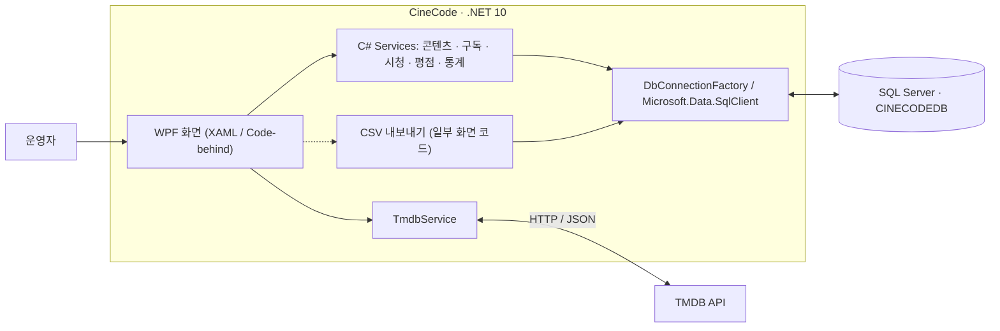
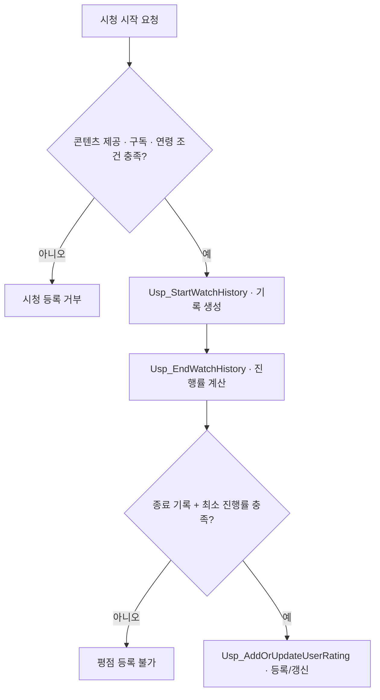

# CineCode
**OTT 콘텐츠 운영 관리 시스템 | WPF · .NET 10**

영화·TV 콘텐츠부터 OTT 구독, 시청 기록, 평점까지 관리하는 Windows 데스크톱 프로그램입니다. **콘텐츠 제공 관계와 구독·시청 조건을 SQL Server에서 검증**하고, 쌓인 데이터를 운영 통계로 활용합니다.

**기술:** C# · WPF(XAML/Code-behind) · Microsoft SQL Server(T-SQL) · TMDB API

<p align="center">
  <a href="CineCode/CineCode/Images/ViewScreenImages/DashboardView.png"></a>
</p>

## 시스템 구조



- **WPF 화면:** 사용자 입력과 화면 이벤트 처리. XAML과 Code-behind를 사용합니다.
- **C# 서비스:** 콘텐츠·구독·시청·평점·통계 기능별 데이터 처리 및 DB 접근을 담당합니다.
- **SQL Server:** 테이블 제약조건과 저장 프로시저로 업무 규칙을 검증합니다.
- **TMDB 연동:** 영화·TV 검색 및 상세 정보를 콘텐츠 등록에 활용합니다.

일부 CSV 내보내기는 화면 코드에서 DB를 직접 조회합니다. 전체가 MVVM 구조로 구현된 것은 아닙니다.

## 핵심 설계와 구현

### 1. 콘텐츠·구독 데이터 일관성

콘텐츠 등록에는 본문 정보뿐 아니라 장르와 OTT 제공 플랫폼 연결이 함께 필요합니다. `ContentService`는 **`SqlTransaction`**으로 등록 작업을 묶고, 성공 시 `Commit`, 오류 시 `Rollback`합니다.

동일 사용자의 구독 기간이 겹치지 않도록 `Usp_AddUserSubscription`에서 날짜를 검사하고, 동시 등록 상황을 고려해 **`UPDLOCK`, `HOLDLOCK`**을 사용했습니다.

[ContentService.cs](CineCode/CineCode/Services/ContentService.cs) · [SQL 저장 프로시저](First_Query.sql)

### 2. 시청 가능 여부와 평점 자격 검증

시청 등록 전 **OTT의 콘텐츠 제공 여부, 활성 구독, 관람 연령**을 검증합니다. 시청 종료 시 러닝타임 대비 진행률을 계산하며, 평점은 종료된 시청 기록이 최소 진행률(기본 **50%**)을 충족해야 등록할 수 있습니다.



평점은 **0~5점, 0.5점 단위**로 제한하며 동일 사용자의 동일 콘텐츠 평점은 기존 기록을 수정합니다.

[WatchHistoryService.cs](CineCode/CineCode/Services/WatchHistoryService.cs) · [UserRatingService.cs](CineCode/CineCode/Services/UserRatingService.cs)

### 3. TMDB API 데이터 통합

`TmdbService`는 `HttpClient`와 `async/await`로 콘텐츠 정보를 검색합니다. 영화(`title`, `release_date`)와 TV(`name`, `first_air_date`)의 응답 차이를 공통 모델로 변환하고 러닝타임·관람 등급을 조회하여 등록에 활용했습니다.

[TmdbService.cs](CineCode/CineCode/Services/TmdbService.cs)

### 4. SQL 운영 통계

시청·구독·평점 데이터를 `JOIN`, `GROUP BY`, 집계 함수 및 저장 프로시저로 분석합니다. **월별 시청 활동, 이전 기간 대비 지표, OTT 시청 시간 점유율, 콘텐츠·장르 순위**를 WPF 통계 화면에 표시합니다.

[StatisticsService.cs](CineCode/CineCode/Services/StatisticsService.cs)

## 데이터베이스 설계

총 **10개 테이블**로 콘텐츠, 장르·OTT 연결, 사용자·구독, 시청 기록·평점, 시스템 설정을 관리합니다. `ContentGenre`와 `ContentOTTProvider`로 다대다 관계를 분리하고, PK·FK·UNIQUE·CHECK 제약조건을 적용했습니다.

<p align="center">
  <a href="CineCode/CineCode/Images/ViewScreenImages/ERD_DIagram.png"></a>
</p>

[테이블 정의 및 저장 프로시저 확인](First_Query.sql)

## 주요 기능 및 화면

| 영역 | 주요 기능 |
|---|---|
| 콘텐츠 | 영화·TV 등록, TMDB 검색, 장르·OTT 매핑 |
| 사용자·구독 | 사용자 정보, OTT별 구독 기간 및 만료 관리 |
| 시청·평점 | 시청 기록, 진행률·완료 처리, 조건 기반 평점 |
| 운영 분석 | 대시보드, 월별·OTT별 통계, CSV 내보내기 |

<table>
  <tr>
    <td align="center" width="50%">
      <a href="CineCode/CineCode/Images/ViewScreenImages/ContentManagementListView.png"></a><br>
      <sub><strong>콘텐츠 관리</strong></sub>
    </td>
    <td align="center" width="50%">
      <a href="CineCode/CineCode/Images/ViewScreenImages/ContentManagementAddView.png"></a><br>
      <sub><strong>콘텐츠 등록</strong></sub>
    </td>
  </tr>
  <tr>
    <td align="center" width="50%">
      <a href="CineCode/CineCode/Images/ViewScreenImages/ContentMappingConnectionsView.png"></a><br>
      <sub><strong>콘텐츠 매핑</strong></sub>
    </td>
    <td align="center" width="50%">
      <a href="CineCode/CineCode/Images/ViewScreenImages/SubscriptionsListView.png"></a><br>
      <sub><strong>구독 관리</strong></sub>
    </td>
  </tr>
  <tr>
    <td align="center" width="50%">
      <a href="CineCode/CineCode/Images/ViewScreenImages/WatchHistoryStartView.png"></a><br>
      <sub><strong>시청 기록</strong></sub>
    </td>
    <td align="center" width="50%">
      <a href="CineCode/CineCode/Images/ViewScreenImages/StatisticsView.png"></a><br>
      <sub><strong>통계</strong></sub>
    </td>
  </tr>
</table>

## 실행 및 빌드

Windows, **.NET 10 SDK**, SQL Server 및 사전에 구성된 `CINECODEDB`가 필요합니다. DB 백업은 공개 저장소에 없으며, [`First_Query.sql`](First_Query.sql)은 **전체 재실행용 초기화 스크립트가 아닌 구조 참고 자료**입니다.

<details>
<summary><strong>Windows PowerShell 환경 변수 설정 및 빌드 명령어</strong></summary>

**Windows PowerShell**에서 API 키를 등록합니다.

```powershell
setx TMDB_API_KEY "본인의_TMDB_API_KEY"
```

다른 SQL Server 인스턴스를 지정해야 할 때만 다음 명령어를 사용합니다.

```powershell
setx CINECODE_DB_SERVER "localhost\SQLEXPRESS"
```

환경 변수 적용을 위해 PowerShell을 새로 열고 **저장소 최상위 폴더**에서 빌드합니다.

```powershell
dotnet build .\CineCode\CineCode\CineCode.csproj
```

</details>
