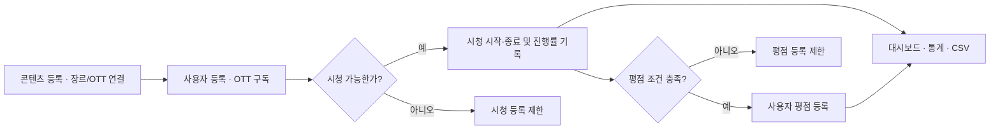
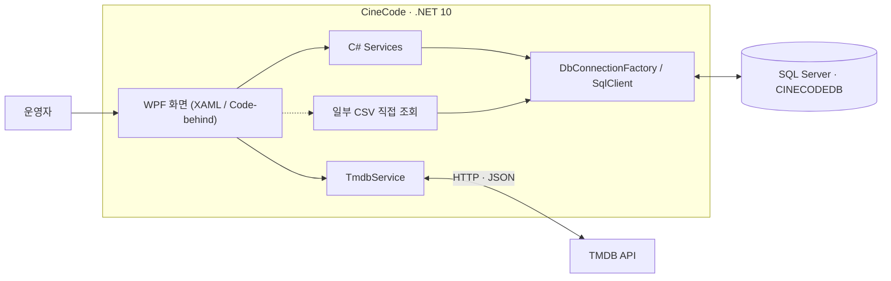

# CineCode
**OTT 콘텐츠·구독·시청 기록 통합 관리 시스템**

CineCode는 **OTT 서비스 운영자를 위한 Windows 관리자 프로그램**입니다. 영화·TV 콘텐츠를 등록하고, 플랫폼별 제공 정보와 사용자 구독을 관리하며, 시청 기록·평점을 바탕으로 운영 현황을 분석합니다.

동영상 재생 앱이 아니라 **콘텐츠와 OTT 운영 데이터를 관리하는 WPF 데스크톱 애플리케이션**입니다.

**기술 스택** — C# · WPF(.NET 10, XAML/Code-behind) · Microsoft SQL Server(T-SQL) · TMDB API

<p align="center">
  <a href="CineCode/CineCode/Images/ViewScreenImages/DashboardView.png"></a>
</p>

## 1. 프로그램 사용 흐름

콘텐츠와 사용자를 준비하고, 구독 여부를 확인해 시청을 기록한 뒤 평점·통계에 활용하는 것이 대표적인 작업 흐름입니다.



각 화면은 위 순서대로만 사용해야 하는 것은 아니며, 기능별로 독립적인 조회·관리도 가능합니다.

## 2. 핵심 기능

### 01. 콘텐츠 등록 및 장르·OTT 매핑

- **콘텐츠 등록** — TMDB에서 영화·TV를 검색하여 제목, 공개일, 줄거리, 포스터, 장르, 러닝타임, 관람 등급 등을 입력 화면으로 가져옵니다.
- **콘텐츠 관리** — 등록한 콘텐츠를 검색·조회하고 수정·삭제합니다.
- **제공 관계 관리** — 장르와 OTT 제공자를 등록·관리하고, 콘텐츠별 장르·OTT 연결을 추가하거나 해제합니다.

**사용 예시** — 콘텐츠를 등록한 뒤 제공 OTT를 연결하면 시청 기록 등록 시 그 플랫폼에서 실제로 제공하도록 설정했는지 검증할 수 있습니다.

**관련 코드** — [콘텐츠 등록 화면](CineCode/CineCode/Views/ContentManagement/ContentAddView.xaml.cs) · [매핑 서비스](CineCode/CineCode/Services/ContentMappingService.cs)

### 02. 사용자·구독 관리

- **사용자 관리** — 사용자 목록 검색·조회, 이름·생년월일·연락처 등의 신규 정보 등록
- **구독 등록** — 사용자와 OTT를 선택해 구독 시작일·만료일·결제 금액 저장
- **구독 운영** — 상태·만료 예정 내역 조회, 구독 한 달 연장 및 해지
- **중복 검증** — 동일 사용자의 동일 OTT 구독 기간이 겹치는 등록 요청 제한

**현재 구현 범위** — 사용자 수정·삭제 *화면은 존재하지만*, 해당 버튼의 실제 DB 수정·삭제 기능은 아직 연결되지 않았습니다.

**관련 코드** — [구독 관리 서비스](CineCode/CineCode/Services/SubscriptionManagementService.cs)

### 03. 시청 기록 관리

- **시청 시작** — 사용자·콘텐츠·OTT를 선택하여 시작 기록 등록
- **등록 조건** — 해당 OTT의 콘텐츠 제공 여부, 시청일의 활성 구독, 사용자 관람 연령 확인
- **시청 종료** — 입력한 시청 시간으로 진행률 및 완료 여부 계산
- **기록 관리** — 검색·조회, 종료된 기록의 시청 시간 수정, 삭제 및 CSV 추출

**핵심 규칙** — 콘텐츠 제공·구독·관람 연령 조건을 충족하지 못하면 시청 시작 기록을 생성하지 않습니다.

**관련 코드** — [WatchHistoryService.cs](CineCode/CineCode/Services/WatchHistoryService.cs)

### 04. 사용자 평점 관리

- **평가 대상** — 사용자별 시청 기록을 확인하여 평가할 수 있는 콘텐츠 목록 제공
- **등록 조건** — 시청이 종료됐고 최소 진행률(기본 **50%**)을 충족해야 평점 등록 가능
- **평점 관리** — **0~5점, 0.5점 단위**로 등록·수정, 기존 평점 삭제 및 목록 검색·필터링

**핵심 규칙** — 실제 시청 이력과 진행률 조건을 확인한 후 평점을 저장합니다.

**관련 코드** — [UserRatingService.cs](CineCode/CineCode/Services/UserRatingService.cs)

### 05. 대시보드·통계·CSV 및 설정

- **대시보드** — 콘텐츠·사용자·OTT·활성 구독 현황과 장르·OTT 미연결 콘텐츠 수 표시
- **운영 통계** — 월별 시청 시간·횟수, 전월·전분기·전년 대비 변화, 플랫폼별 시청 점유율과 인기 콘텐츠·장르 확인
- **조회 필터** — 기간·콘텐츠 유형·OTT·장르·검색어 등 조건 선택
- **내보내기** — 사용자·콘텐츠·구독·시청·평점 등의 관리 데이터를 CSV 파일로 저장
- **환경 설정** — CSV 저장 경로와 평점 등록의 최소 시청 진행률 관리

**관련 코드** — [DashboardService.cs](CineCode/CineCode/Services/DashboardService.cs) · [StatisticsService.cs](CineCode/CineCode/Services/StatisticsService.cs)

## 3. 시스템 구조



| 구성 | 역할 |
|---|---|
| **WPF 화면** | 입력·검색·조회·화면 전환 |
| **C# Service** | 기능별 데이터 처리와 DB 접근 |
| **SQL Server** | 데이터 저장, 제약조건과 저장 프로시저를 통한 업무 규칙 검증 |
| **TMDB API** | 영화·TV 외부 정보 검색 및 등록 지원 |

**구현 특징** — WPF Code-behind와 Service를 사용합니다. 일부 CSV 기능은 화면 코드에서 SQL을 직접 실행하며, 전체를 MVVM 구조로 소개하지 않습니다.

## 4. 데이터베이스 설계

- **테이블 구성** — 콘텐츠·장르·OTT·사용자·구독·시청·평점·설정을 총 **10개 테이블**로 관리합니다.
- **관계 설계** — `ContentGenre`, `ContentOTTProvider`로 콘텐츠와 장르·OTT의 다대다 관계를 분리했습니다.
- **무결성 관리** — PK·FK·UNIQUE·CHECK 제약조건 및 저장 프로시저를 적용했습니다.

<p align="center">
  <a href="CineCode/CineCode/Images/ViewScreenImages/ERD_DIagram.png"></a>
</p>

**관련 구현** — [ContentService.cs](CineCode/CineCode/Services/ContentService.cs) · [TmdbService.cs](CineCode/CineCode/Services/TmdbService.cs) · [테이블·저장 프로시저](First_Query.sql)

## 5. 주요 기술 과제와 해결

### 01. TMDB API 데이터 통합 — 영화·TV 응답 구조 차이 해결

- **과제** — TMDB의 영화와 TV 콘텐츠는 검색 API 경로와 데이터 필드가 서로 달라 동일한 등록 화면에서 처리하기 어렵습니다. 영화는 `title`·`release_date`, TV는 `name`·`first_air_date`를 사용합니다.
- **구현** — `TmdbService`에서 콘텐츠 유형별 API를 `HttpClient`와 `async/await`로 호출한 후, 응답을 공통 `TmdbSearchResultModel`로 변환했습니다. 러닝타임과 관람 등급도 유형별 상세 API에서 조회합니다.
- **결과** — 영화와 TV의 데이터 형식 차이를 서비스에서 흡수하여, 콘텐츠 등록 화면에서는 통일된 데이터 모델을 활용하도록 구성했습니다.

**관련 코드** — [TmdbService.cs](CineCode/CineCode/Services/TmdbService.cs) · [ContentAddView.xaml.cs](CineCode/CineCode/Views/ContentManagement/ContentAddView.xaml.cs)

### 02. SQL 기반 운영 통계 — 저장 데이터를 분석 지표로 가공

- **과제** — 시청 기록·구독·평점이 서로 다른 테이블에 저장되어 있어 목록 조회만으로는 기간별 이용 변화나 플랫폼별 활동을 파악하기 어렵습니다.
- **구현** — `StatisticsService`에서 SQL `JOIN`, `GROUP BY`, 집계 함수와 저장 프로시저를 사용해 기간별 시청 횟수·시간을 집계하고, 이전 월·분기·연도의 요약 지표와 비교했습니다. OTT별 시청 시간 점유율과 인기 콘텐츠·장르 순위도 조회합니다.
- **결과** — 원본 운영 데이터를 **기간 비교, 플랫폼 점유율, 인기 콘텐츠 순위** 등 관리자가 파악할 수 있는 지표로 변환해 WPF 통계 화면에 제공합니다.

**관련 코드** — [StatisticsService.cs](CineCode/CineCode/Services/StatisticsService.cs) · [First_Query.sql](First_Query.sql)

## 6. 실제 프로그램 화면

<table>
  <tr>
    <td align="center" width="50%">
      <a href="CineCode/CineCode/Images/ViewScreenImages/ContentManagementListView.png"></a><br>
      <sub><strong>콘텐츠 관리</strong></sub>
    </td>
    <td align="center" width="50%">
      <a href="CineCode/CineCode/Images/ViewScreenImages/ContentManagementAddView.png"></a><br>
      <sub><strong>콘텐츠 등록</strong></sub>
    </td>
  </tr>
  <tr>
    <td align="center" width="50%">
      <a href="CineCode/CineCode/Images/ViewScreenImages/ContentMappingConnectionsView.png"></a><br>
      <sub><strong>콘텐츠 매핑</strong></sub>
    </td>
    <td align="center" width="50%">
      <a href="CineCode/CineCode/Images/ViewScreenImages/SubscriptionsListView.png"></a><br>
      <sub><strong>구독 관리</strong></sub>
    </td>
  </tr>
  <tr>
    <td align="center" width="50%">
      <a href="CineCode/CineCode/Images/ViewScreenImages/WatchHistoryStartView.png"></a><br>
      <sub><strong>시청 기록</strong></sub>
    </td>
    <td align="center" width="50%">
      <a href="CineCode/CineCode/Images/ViewScreenImages/StatisticsView.png"></a><br>
      <sub><strong>통계</strong></sub>
    </td>
  </tr>
</table>

## 7. 실행 및 빌드

**필요 환경** — Windows · .NET 10 SDK · SQL Server · 사전에 구성된 `CINECODEDB` · TMDB API 키

DB 백업 파일은 공개 저장소에 포함되지 않습니다. [`First_Query.sql`](First_Query.sql)은 전체 재실행용 초기화 스크립트가 아니라 DB 구조 참고 자료입니다.

<details>
<summary><strong>Windows PowerShell 환경 변수 설정 및 빌드 명령어</strong></summary>

**PowerShell에서 TMDB API 키 등록**

```powershell
setx TMDB_API_KEY "본인의_TMDB_API_KEY"
```

**다른 SQL Server 주소를 사용할 때(선택 사항)**

```powershell
setx CINECODE_DB_SERVER "localhost\SQLEXPRESS"
```

환경 변수 등록 후 PowerShell을 새로 열고, **저장소 최상위 폴더**에서 빌드합니다.

```powershell
dotnet build .\CineCode\CineCode\CineCode.csproj
```

</details>
