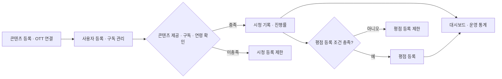

# CineCode
**OTT 콘텐츠 및 서비스 운영 관리 시스템**

CineCode는 **영화·TV 콘텐츠, OTT 플랫폼, 사용자 구독, 시청 기록과 평점을 통합 관리하는 WPF 데스크톱 프로그램**입니다. 콘텐츠를 직접 등록하거나 TMDB에서 검색하고, 구독과 시청 기록을 관리한 뒤 운영 현황을 통계로 확인할 수 있습니다.

**기술 스택** — C# · WPF(.NET 10, XAML / Code-behind) · Microsoft SQL Server(T-SQL) · TMDB API

<p align="center">
  <a href="CineCode/CineCode/Images/ViewScreenImages/DashboardView.png"></a>
</p>

## 1. 주요 기능

### 01. 콘텐츠 및 OTT 제공 정보 관리

- **콘텐츠 등록·수정** — 영화·TV 콘텐츠를 등록하고 제목, 공개일, 줄거리, 포스터, 러닝타임, 관람 등급 등을 관리합니다.
- **TMDB 검색** — 영화·TV 정보를 검색해 등록 화면에 자동으로 채우고, 필요하면 직접 입력하거나 수정합니다.
- **장르·OTT 매핑** — 장르와 OTT 제공자를 관리하고, 콘텐츠와 해당 장르·플랫폼 간 연결 관계를 추가·해제합니다.

**관련 구현** — [콘텐츠 등록 화면](CineCode/CineCode/Views/ContentManagement/ContentAddView.xaml.cs) · [콘텐츠 매핑](CineCode/CineCode/Services/ContentMappingService.cs)

### 02. 사용자 및 OTT 구독 관리

- **사용자 관리** — 사용자 정보 등록, 목록 검색·조회 및 연령·구독 상태 확인
- **구독 등록** — 사용자별 OTT 플랫폼, 구독 기간, 결제 금액 기록
- **구독 운영** — 활성·만료 예정 구독 조회, 기존 구독 한 달 연장 및 해지
- **기간 검증** — 같은 사용자·OTT의 구독 기간 중복 등록 방지

**관련 구현** — [사용자 관리 화면](CineCode/CineCode/Views/UserManagementView.xaml.cs) · [구독 관리 서비스](CineCode/CineCode/Services/SubscriptionManagementService.cs)

### 03. 시청 기록 및 평점 관리

- **시청 시작** — 사용자·콘텐츠·OTT를 선택하고, **콘텐츠 제공 여부·유효 구독·관람 연령**을 확인한 뒤 기록합니다.
- **시청 종료** — 시청 시간과 러닝타임을 비교해 진행률 및 완료 여부를 계산합니다. 기록 조회·수정·삭제도 지원합니다.
- **평점 등록** — 종료된 시청 기록이 최소 진행률(기본 **50%**)을 충족하면 **0~5점(0.5점 단위)**으로 평가합니다. 기존 평점 수정·삭제도 가능합니다.

**관련 구현** — [시청 기록 서비스](CineCode/CineCode/Services/WatchHistoryService.cs) · [평점 서비스](CineCode/CineCode/Services/UserRatingService.cs)

### 04. 운영 현황 및 통계 관리

- **대시보드** — 콘텐츠·사용자·OTT·활성 구독 현황, 장르·OTT 연결 누락 현황을 요약합니다.
- **통계** — 월별 시청 횟수·시간, 기간별 지표 비교, OTT 시청 시간 점유율, 인기 콘텐츠·장르를 분석합니다.
- **조회·내보내기** — 기간과 콘텐츠·OTT 등의 조건으로 조회하고 주요 관리 데이터를 CSV로 저장합니다.
- **환경 설정** — CSV 저장 경로와 평점 등록 최소 진행률을 관리합니다.

**관련 구현** — [대시보드 서비스](CineCode/CineCode/Services/DashboardService.cs) · [통계 서비스](CineCode/CineCode/Services/StatisticsService.cs)

## 2. 업무 처리 흐름

콘텐츠와 사용자의 정보를 준비한 뒤 구독에 따라 시청을 기록하고, 그 결과를 평점과 통계에 활용합니다.



**핵심 규칙** — 시청과 평점을 화면 입력만으로 처리하지 않고, SQL Server 저장 프로시저에서도 등록 가능 조건을 확인합니다. 위 흐름은 대표적인 작업 예시입니다.

## 3. 시스템 구조


| 구성 | 역할 |
|---|---|
| **WPF** | 관리 화면 및 사용자 입력·이벤트 처리 |
| **C# Service** | 기능별 조회·등록·수정·삭제와 DB 연동 |
| **SQL Server** | 데이터 저장 및 제약조건·저장 프로시저를 이용한 업무 규칙 검증 |
| **TMDB API** | 영화·TV 외부 정보 검색 및 등록 지원 |

**설계 특징** — XAML Code-behind와 Service 클래스로 구성했으며, 일부 CSV 기능은 화면 코드에서 직접 DB에 접근합니다. 전체를 MVVM 패턴으로 구현한 구조는 아닙니다.

## 4. 데이터베이스 설계

- **10개 테이블** — 콘텐츠·장르·OTT, 사용자·구독, 시청·평점 및 환경 설정 정보를 분리해 관리
- **다대다 관계** — `ContentGenre`·`ContentOTTProvider`로 콘텐츠와 장르·플랫폼 관계 구성
- **무결성 확보** — PK·FK·UNIQUE·CHECK 제약조건 및 저장 프로시저로 중복·잘못된 데이터 등록 방지

<p align="center">
  <a href="CineCode/CineCode/Images/ViewScreenImages/ERD_DIagram.png"></a>
</p>

**SQL 설계** — [테이블·제약조건·저장 프로시저](First_Query.sql)

## 5. 문제 해결 및 데이터 처리 경험

### 01. TMDB API 데이터 통합 — 영화·TV 응답 차이 처리

- **문제** — TMDB 영화와 TV는 검색 주소뿐 아니라 제목·공개일 필드가 서로 다릅니다. 영화는 `title`·`release_date`, TV는 `name`·`first_air_date`를 사용합니다.
- **해결** — `TmdbService`에서 콘텐츠 유형별 API를 `HttpClient`·`async/await`로 호출하고, 응답을 공통 `TmdbSearchResultModel`로 변환했습니다. 러닝타임·관람 등급도 유형별 상세 API에서 조회합니다.
- **결과** — 서로 다른 외부 데이터 구조를 등록 화면에서 하나의 모델로 처리하여 입력 과정을 간소화했습니다.

**구현 코드** — [TmdbService.cs](CineCode/CineCode/Services/TmdbService.cs) · [ContentAddView.xaml.cs](CineCode/CineCode/Views/ContentManagement/ContentAddView.xaml.cs)

### 02. SQL 기반 운영 통계 — 저장 데이터를 분석 지표로 변환

- **문제** — 시청·구독·평점 정보가 여러 테이블에 분산되어 있어 단순 목록만으로는 기간별 변화와 OTT 이용 현황을 비교하기 어렵습니다.
- **해결** — `StatisticsService`에서 SQL `JOIN`·`GROUP BY`·집계 함수와 저장 프로시저를 사용해 월별 시청 횟수·시간을 집계하고, 이전 월·분기·연도의 주요 지표와 비교하도록 구성했습니다. OTT별 시청 시간 비중, 인기 콘텐츠·장르 순위도 계산합니다.
- **결과** — 원본 데이터를 **기간 비교·플랫폼 점유율·인기 순위** 등의 운영 지표로 가공하여 WPF 화면에서 확인할 수 있게 했습니다.

**구현 코드** — [StatisticsService.cs](CineCode/CineCode/Services/StatisticsService.cs) · [First_Query.sql](First_Query.sql)

## 6. 프로그램 화면

<table>
  <tr>
    <td align="center" width="50%">
      <a href="CineCode/CineCode/Images/ViewScreenImages/ContentManagementListView.png"></a><br>
      <sub><strong>콘텐츠 관리</strong></sub>
    </td>
    <td align="center" width="50%">
      <a href="CineCode/CineCode/Images/ViewScreenImages/ContentManagementAddView.png"></a><br>
      <sub><strong>콘텐츠 등록</strong></sub>
    </td>
  </tr>
  <tr>
    <td align="center" width="50%">
      <a href="CineCode/CineCode/Images/ViewScreenImages/ContentMappingConnectionsView.png"></a><br>
      <sub><strong>콘텐츠 매핑</strong></sub>
    </td>
    <td align="center" width="50%">
      <a href="CineCode/CineCode/Images/ViewScreenImages/SubscriptionsListView.png"></a><br>
      <sub><strong>구독 관리</strong></sub>
    </td>
  </tr>
  <tr>
    <td align="center" width="50%">
      <a href="CineCode/CineCode/Images/ViewScreenImages/WatchHistoryStartView.png"></a><br>
      <sub><strong>시청 기록</strong></sub>
    </td>
    <td align="center" width="50%">
      <a href="CineCode/CineCode/Images/ViewScreenImages/StatisticsView.png"></a><br>
      <sub><strong>통계</strong></sub>
    </td>
  </tr>
</table>

## 7. 실행 및 빌드

**필요 환경** — Windows · .NET 10 SDK · SQL Server · 사전에 구성된 `CINECODEDB` · TMDB API 키

**DB 준비** — 공개 저장소에는 DB 백업 파일이 없습니다. [`First_Query.sql`](First_Query.sql)은 구조 참고 자료이며 **전체 재실행용 초기화 스크립트가 아닙니다.**

<details>
<summary><strong>Windows PowerShell 환경 변수 설정 및 빌드 명령어</strong></summary>

**PowerShell에서 TMDB API 키 등록**

```powershell
setx TMDB_API_KEY "본인의_TMDB_API_KEY"
```

**별도 SQL Server 인스턴스 지정(필요한 경우)**

```powershell
setx CINECODE_DB_SERVER "localhost\SQLEXPRESS"
```

환경 변수 등록 후 PowerShell을 새로 열고 **저장소 최상위 폴더**에서 빌드합니다.

```powershell
dotnet build .\CineCode\CineCode\CineCode.csproj
```

</details>
