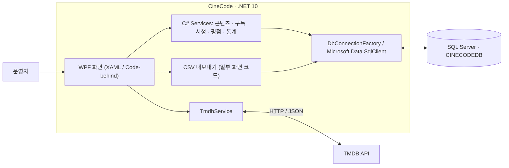
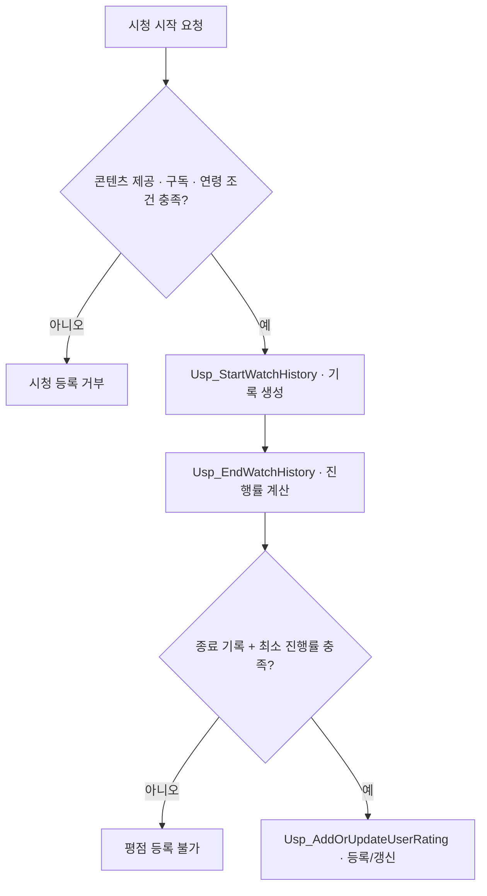

# CineCode
**OTT 콘텐츠 운영 관리 시스템 · WPF / .NET 10**

영화·TV 콘텐츠와 OTT 구독, 시청 기록, 평점을 통합 관리하는 Windows 데스크톱 프로그램입니다. **구독·시청·평점의 업무 규칙을 SQL Server에서 검증**하고, 운영 현황을 통계로 제공합니다.

**개발 기술** — C# · WPF(XAML / Code-behind) · SQL Server(T-SQL) · TMDB API

## 1. 시스템 구조



| 구성 | 역할 |
|---|---|
| **WPF 화면** | XAML UI와 Code-behind에서 사용자 입력·화면 이벤트 처리 |
| **C# Service** | 콘텐츠, 구독, 시청, 평점, 통계 기능별 처리 |
| **SQL Server** | 테이블 제약조건, 저장 프로시저, 업무 규칙 검증 |
| **TMDB API** | 영화·TV 검색 및 상세 정보 조회 |

**구현 특징** — 대부분의 DB 접근은 서비스에서 `Microsoft.Data.SqlClient`로 처리하며, 일부 CSV 내보내기는 화면 코드에서 DB를 직접 조회합니다.

## 2. 핵심 기술 구현

### 01. 콘텐츠 등록 — 트랜잭션으로 부분 저장 방지

- **문제** — 콘텐츠 정보만 저장되고 장르·OTT 연결이 실패하면 불완전한 데이터가 남을 수 있습니다.
- **구현** — `SqlTransaction`으로 콘텐츠·장르·OTT 연결을 하나로 묶어 `Commit` 또는 `Rollback` 처리했습니다.
- **효과** — 관련 정보가 함께 저장되거나 모두 취소되도록 구성했습니다.

**코드** — [ContentService.cs](CineCode/CineCode/Services/ContentService.cs)

### 02. 구독 관리 — 기간 중복 및 동시 요청 제어

- **문제** — 동일 사용자의 OTT 구독 기간이 겹치거나 여러 요청이 동시에 등록될 수 있습니다.
- **구현** — `Usp_AddUserSubscription`에서 기간 겹침을 검사하고 `UPDLOCK`, `HOLDLOCK`을 적용했습니다.
- **효과** — 구독 데이터의 중복 발생 위험을 줄이고 일관성을 유지하도록 설계했습니다.

**코드** — [First_Query.sql](First_Query.sql)

### 03. 시청·평점 — 업무 조건을 데이터베이스에서 검증

- **시청 시작** — 콘텐츠가 해당 OTT에서 제공되는지, 구독이 유효한지, 관람 연령을 충족하는지 확인합니다.
- **시청 종료** — 러닝타임과 시청 시간으로 진행률·완료 여부를 계산합니다.
- **평점 등록** — 종료된 시청 기록이 최소 진행률(기본 **50%**)을 만족해야 평가할 수 있으며, 점수는 **0~5점 / 0.5점 단위**로 제한합니다.



**코드** — [WatchHistoryService.cs](CineCode/CineCode/Services/WatchHistoryService.cs) · [UserRatingService.cs](CineCode/CineCode/Services/UserRatingService.cs)

### 04. TMDB 연동 — 영화·TV 데이터를 공통 구조로 변환

- **문제** — 영화와 TV는 API 경로와 제목·공개일 필드가 서로 다릅니다.
- **구현** — `HttpClient`, `async/await`로 조회한 응답을 공통 모델로 변환하고 러닝타임·관람 등급을 추가 조회했습니다.
- **효과** — 콘텐츠 유형에 관계없이 검색 정보를 등록 화면에서 활용할 수 있습니다.

**코드** — [TmdbService.cs](CineCode/CineCode/Services/TmdbService.cs)

### 05. 운영 통계 — 저장된 데이터를 관리 지표로 활용

- **데이터** — 시청 기록, 구독, 평점 및 콘텐츠 정보
- **처리** — SQL `JOIN`, `GROUP BY`, 집계 함수와 저장 프로시저 활용
- **제공** — 월별 시청 활동, 기간 비교, OTT 점유율, 인기 콘텐츠·장르 순위

**코드** — [StatisticsService.cs](CineCode/CineCode/Services/StatisticsService.cs)

## 3. 데이터베이스 설계

- **테이블 구성** — 콘텐츠·장르·OTT, 사용자·구독, 시청·평점, 시스템 설정 등 총 **10개 테이블**
- **관계 설계** — `ContentGenre`, `ContentOTTProvider` 중간 테이블로 다대다 관계 분리
- **무결성 관리** — PK·FK·UNIQUE·CHECK 제약조건 및 저장 프로시저 사용

<p align="center">
  <a href="CineCode/CineCode/Images/ViewScreenImages/ERD_DIagram.png"></a>
</p>

**상세 설계** — [테이블 정의 및 저장 프로시저](First_Query.sql)

## 4. 주요 기능과 화면

| 기능 | 내용 |
|---|---|
| **콘텐츠·매핑** | TMDB 검색, 콘텐츠 등록, 장르·OTT 연결 |
| **사용자·구독** | 사용자 관리, 구독 기간 및 만료 정보 조회 |
| **시청·평점** | 시청 기록·진행률 관리, 조건 기반 평점 처리 |
| **통계·내보내기** | 대시보드, 운영 지표 분석, CSV 저장 |

**대시보드**

<p align="center">
  <a href="CineCode/CineCode/Images/ViewScreenImages/DashboardView.png"></a>
</p>

**기능별 화면**

<table>
  <tr>
    <td align="center" width="50%">
      <a href="CineCode/CineCode/Images/ViewScreenImages/ContentManagementListView.png"></a><br>
      <sub><strong>콘텐츠 관리</strong></sub>
    </td>
    <td align="center" width="50%">
      <a href="CineCode/CineCode/Images/ViewScreenImages/ContentManagementAddView.png"></a><br>
      <sub><strong>콘텐츠 등록</strong></sub>
    </td>
  </tr>
  <tr>
    <td align="center" width="50%">
      <a href="CineCode/CineCode/Images/ViewScreenImages/ContentMappingConnectionsView.png"></a><br>
      <sub><strong>콘텐츠 매핑</strong></sub>
    </td>
    <td align="center" width="50%">
      <a href="CineCode/CineCode/Images/ViewScreenImages/SubscriptionsListView.png"></a><br>
      <sub><strong>구독 관리</strong></sub>
    </td>
  </tr>
  <tr>
    <td align="center" width="50%">
      <a href="CineCode/CineCode/Images/ViewScreenImages/WatchHistoryStartView.png"></a><br>
      <sub><strong>시청 기록</strong></sub>
    </td>
    <td align="center" width="50%">
      <a href="CineCode/CineCode/Images/ViewScreenImages/StatisticsView.png"></a><br>
      <sub><strong>통계</strong></sub>
    </td>
  </tr>
</table>

## 5. 실행 및 빌드

**필요 환경** — Windows · .NET 10 SDK · SQL Server · 구성된 `CINECODEDB` · TMDB API 키

**DB 준비** — 공개 저장소에는 DB 백업을 포함하지 않았습니다. [`First_Query.sql`](First_Query.sql)은 구조 참고 자료이며 **전체 재실행용 초기화 스크립트가 아닙니다.**

<details>
<summary><strong>Windows PowerShell 설정 및 빌드 명령어 보기</strong></summary>

**PowerShell에서 TMDB API 키 등록**

```powershell
setx TMDB_API_KEY "본인의_TMDB_API_KEY"
```

**SQL Server 주소 지정(필요한 경우만)**

```powershell
setx CINECODE_DB_SERVER "localhost\SQLEXPRESS"
```

환경 변수 적용을 위해 PowerShell을 새로 열고, **저장소 최상위 폴더**에서 빌드합니다.

```powershell
dotnet build .\CineCode\CineCode\CineCode.csproj
```

</details>
